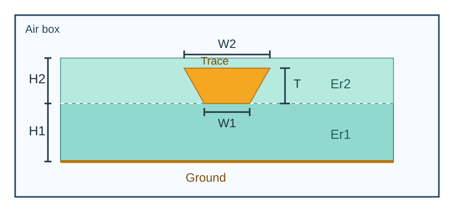

# 微带线准静态阻抗计算

使用 Gmsh、scikit-fem 和 SciPy，对双层介质、有限宽地、矩形或梯形信号线进行二维静电有限元计算，输出准 TEM 阻抗、单位长度电容/电感、有效介电常数和相速度。无需 Palace 或其他外部电磁求解器。

**[打开 HTML 在线文档](https://weixuep.github.io/microstrip-quasistatic-impedance/)** · [English](README.md) · [文档源码入口](doc/index.md)



## 快速运行

需要 Python **3.10+**。所有输入长度均为 **mil**，`1 mil = 25.4 μm`。

Windows PowerShell：

```powershell
python -m venv .venv
.\.venv\Scripts\python.exe -m pip install -r requirements.txt
.\.venv\Scripts\python.exe microstrip_quasistatic.py
```

Linux/macOS：

```bash
python3 -m venv .venv
.venv/bin/python -m pip install -r requirements.txt
.venv/bin/python microstrip_quasistatic.py
```

输出默认位于脚本旁的 `output/`：`microstrip.msh` 为网格，`result.json` 包含计算结果。阻抗字段为 `characteristic_impedance_ohm`，单位为 Ω。

## 文档导航

| 内容 | 文档 |
| --- | --- |
| 安装、首次运行和自定义案例 | [快速开始](doc/quickstart.md) |
| 几何坐标、单位和边界条件 | [模型定义](doc/geometry.md) |
| 全部参数、默认值和网格设置 | [命令行参考](doc/cli.md) |
| JSON 字段和网格文件注意事项 | [输出说明](doc/output.md) |
| 两次静电求解与阻抗公式 | [计算原理](doc/theory.md) |
| 网格收敛和 Polar SI9000 历史对照 | [验证说明](doc/validation.md) |
| 环境与运行问题 | [常见问题](doc/troubleshooting.md) |
| Python API、本地预览与 GitHub Pages 发布 | [开发说明](doc/development.md) |

## 本地文档网站

在虚拟环境中安装独立的文档依赖：

```shell
python -m pip install -r requirements-docs.txt
python -m mkdocs serve
```

严格构建 HTML：`python -m mkdocs build --strict`，产物在 `site/`。推送文档到 `main` 后，GitHub Actions 自动构建并发布至 GitHub Pages；首次配置见[发布指南](doc/development.md#github-pages)。

本模型采用理想导体与有限空气盒，不包含损耗、频率色散或三维全波效应。使用前应检查网格和计算域收敛。项目采用 [Apache License 2.0](LICENSE)。
